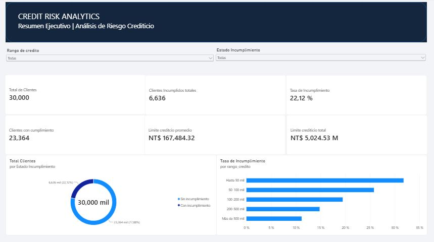
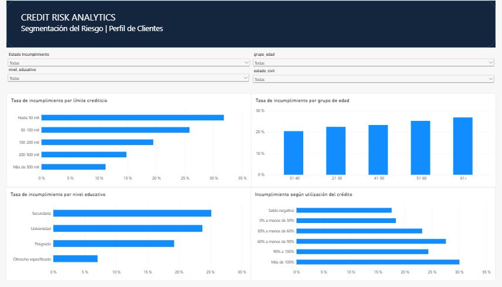
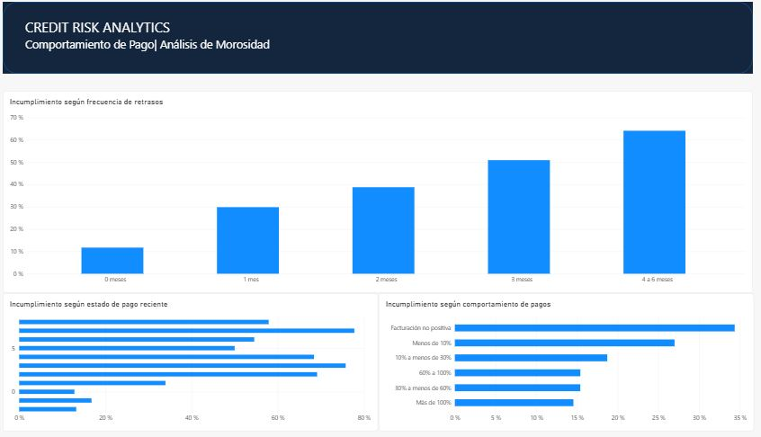

# Credit Risk Analytics | Análisis de Riesgo Crediticio

## Descripción del proyecto

Proyecto de análisis de riesgo crediticio desarrollado mediante Python, PostgreSQL y Power BI, utilizando información histórica de 30,000 clientes de tarjetas de crédito de Taiwán.

El objetivo es identificar patrones asociados al incumplimiento de pagos, evaluar el comportamiento financiero de los clientes y construir un dashboard interactivo que facilite el análisis de la cartera crediticia.

## Herramientas utilizadas

- **Python:** exploración, limpieza y transformación de datos.
- **PostgreSQL 18:** almacenamiento, consultas SQL y creación de vistas analíticas.
- **Power BI Desktop:** modelado, medidas DAX y visualización interactiva.
- **Visual Studio Code:** desarrollo y organización del proyecto.

## Fuente de datos

**Dataset:** Default of Credit Card Clients  
**Fuente:** UCI Machine Learning Repository  
**Periodo:** 2005  
**Observaciones:** 30,000 clientes  
**Variable objetivo:** incumplimiento de pago en el mes siguiente.

Enlace: https://archive.ics.uci.edu/dataset/350/default+of+credit+card+clients

## Metodología

### 1. Exploración y limpieza con Python

- Revisión de la estructura y calidad del dataset.
- Verificación de valores faltantes e identificadores duplicados.
- Estandarización de variables.
- Creación de grupos de edad, educación, estado civil y límite crediticio.
- Exportación de los datos procesados a CSV.

### 2. Análisis con PostgreSQL

- Importación de 30,000 registros.
- Cálculo de indicadores generales de la cartera.
- Segmentación por características de los clientes.
- Análisis del historial de retrasos.
- Construcción de indicadores aproximados de utilización crediticia y comportamiento de pagos.
- Creación de la vista `public.vw_credit_risk` para Power BI.

### 3. Visualización con Power BI

Desarrollo de un dashboard interactivo de tres páginas:

**Resumen Ejecutivo**
- Indicadores generales de la cartera.
- Distribución de clientes según incumplimiento.
- Riesgo por límite crediticio.

**Segmentación del Riesgo**
- Límite crediticio.
- Grupo de edad.
- Nivel educativo.
- Utilización del crédito.

**Comportamiento de Pagos**
- Frecuencia de retrasos.
- Estado de pago reciente.
- Ratio de pagos y facturación.

## Dashboard interactivo

### Página 1. Resumen Ejecutivo

### Página 2. Segmentación del Riesgo

### Página 3. Comportamiento de Pagos

## Principales resultados

| Indicador | Resultado |
|---|---:|
| Clientes analizados | 30,000 |
| Clientes con incumplimiento | 6,636 |
| Tasa general de incumplimiento | 22.12% |
| Límite crediticio promedio | NT$ 167,484.32 |
| Incumplimiento con 4–6 meses de retrasos | 64.05% |
| Incumplimiento con límite hasta NT$50,000 | 31.79% |
| Incumplimiento con utilización superior al 100% | 30.05% |

## Hallazgos

**Historial de pagos:** los clientes con retrasos recurrentes presentan tasas de incumplimiento considerablemente superiores a quienes no registran retrasos positivos.

**Límite crediticio:** los segmentos de menor límite presentan mayores tasas de incumplimiento en la muestra analizada.

**Utilización crediticia:** los clientes con saldos facturados superiores a sus límites registran una mayor proporción de incumplimiento.

**Comportamiento de pagos:** los ratios bajos entre pagos acumulados y saldos facturados se asocian con mayores tasas de incumplimiento.

## Conclusiones

El análisis evidencia la importancia del historial de pagos y de los indicadores financieros para identificar segmentos de mayor riesgo crediticio.

Los resultados pueden orientar el diseño de indicadores de seguimiento, alertas tempranas y futuras investigaciones de modelos predictivos de incumplimiento.

## Limitaciones

- Los datos corresponden a clientes de Taiwán de 2005 y no representan necesariamente el mercado financiero peruano actual.
- Los resultados son descriptivos y no establecen causalidad.
- La utilización crediticia se aproxima mediante el saldo facturado y el límite de crédito.
- El ratio de pagos y facturación no representa necesariamente una tasa exacta de amortización.
- No se desarrolló ni validó un modelo predictivo en esta etapa.

## Autor

Proyecto académico de portafolio profesional enfocado en Data Analytics, Business Intelligence y análisis de riesgo financiero.